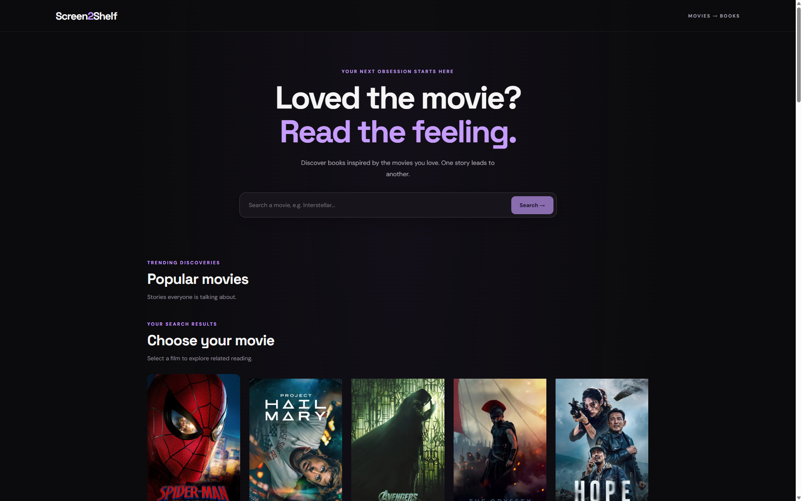
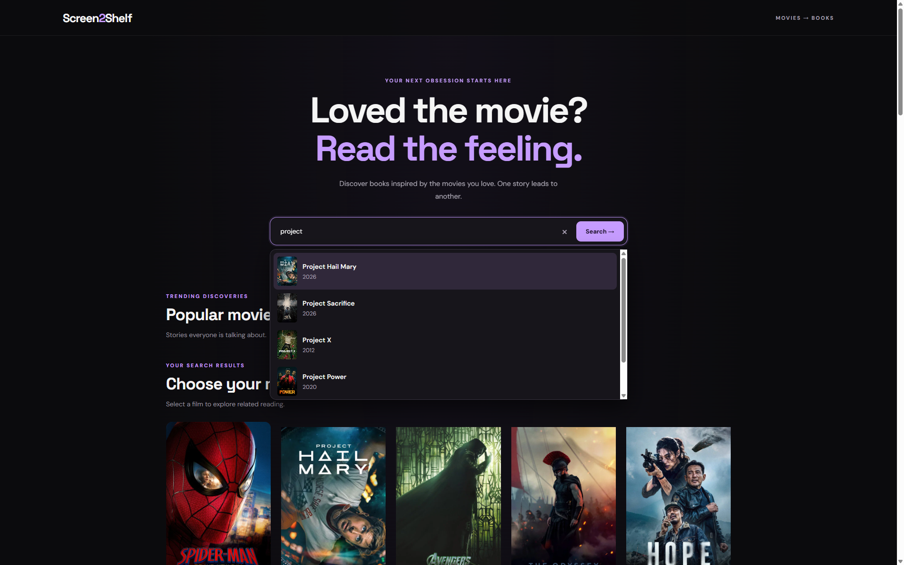
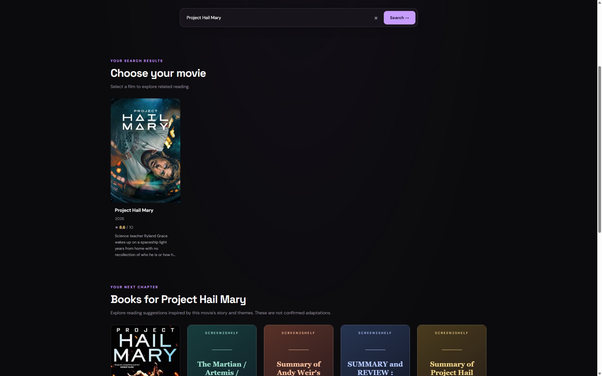
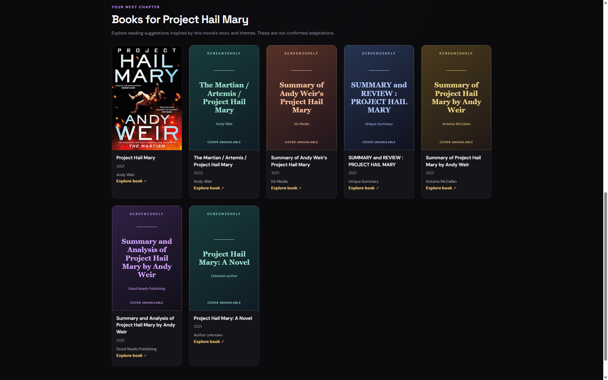
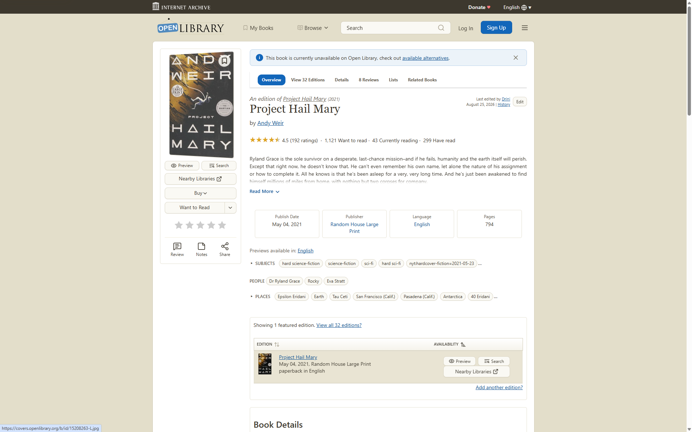

# Screen2Shelf

**From the movies you love to the books you might love next.**

Screen2Shelf is a movie discovery web app that helps you explore books inspired by the stories, themes, and genres of your favorite movies.

Search for a movie, explore what's popular or currently playing in India, and discover related books — all in one place.

**[Live Demo](https://screen2-shelf.vercel.app/)** · **[GitHub Repository](https://github.com/KSatyamLabs/Screen2Shelf)**

## Preview



## Screenshots

### Movie Search



### Book Recommendations



### Book Covers



### Movie-to-Book Discovery



## Features

- **Movie Search** — Find movies using titles and search suggestions.
- **Discover Movies** — Explore popular movies and movies currently playing in India.
- **Book Recommendations** — Discover books related to a selected movie's title, story, and genres.
- **Explore Similar Themes** — Broaden book discovery when you want more recommendations.
- **Responsive Interface** — Browse movies and books through a dark-themed interface.

## Tech Stack

- **Frontend:** React, JavaScript, Vite
- **Styling:** CSS
- **Movie Data:** [The Movie Database (TMDB)](https://www.themoviedb.org/)
- **Book Data:** [Open Library](https://openlibrary.org/)

## Getting Started

### Prerequisites

- [Node.js](https://nodejs.org/) (includes npm)
- A TMDB API credential

### Installation

1. Clone the repository:

   ```bash
   git clone https://github.com/KSatyamLabs/Screen2Shelf.git
   cd Screen2Shelf
   ```

2. Install dependencies:

   ```bash
   npm install
   ```

3. Create a `.env` file in the project's root directory and add your TMDB credential:

   ```env
   VITE_TMDB_API_KEY=your_tmdb_api_credential
   ```

4. Start the development server:

   ```bash
   npm run dev
   ```

5. Open the local URL shown in your terminal.

### Build for Production

Create a production build:

```bash
npm run build
```

To preview the production build locally:

```bash
npm run preview
```

## APIs and Acknowledgements

- Movie information and movie artwork are provided by [The Movie Database (TMDB)](https://www.themoviedb.org/).
- Book search results and available cover images are provided by [Open Library](https://openlibrary.org/).

This product uses the TMDB API but is not endorsed or certified by TMDB.

## Environment Variables and Security

- Never commit your `.env` file or publish credentials in your source code.
- The `VITE_` prefix exposes environment variables to browser-side code. Treat the TMDB credential used by this frontend as visible to users, and configure appropriate restrictions or usage controls where available.
- Keep `.env` excluded through `.gitignore`.

## Project Status

Screen2Shelf is a personal project built to explore movie discovery, public APIs, and book recommendations.

## License

This project is licensed under the [MIT License](LICENSE).

Copyright (c) 2026 Satyam Kalapahad